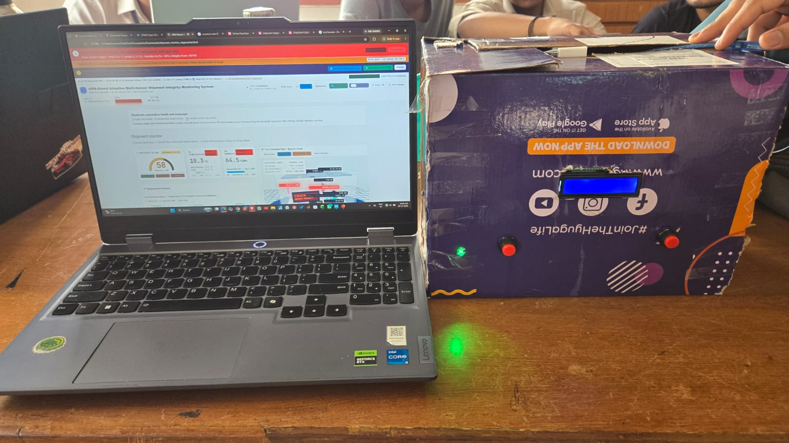
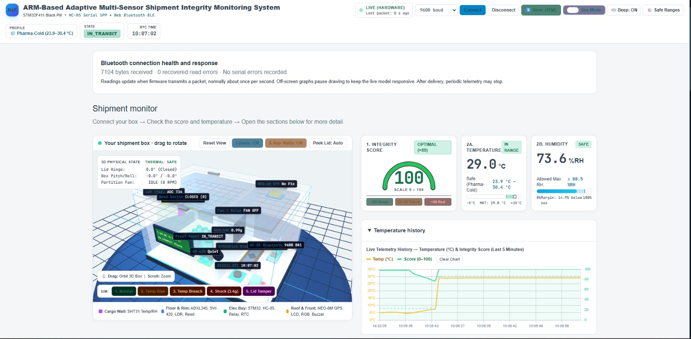
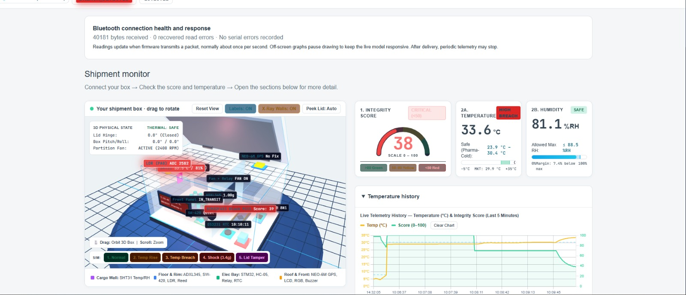
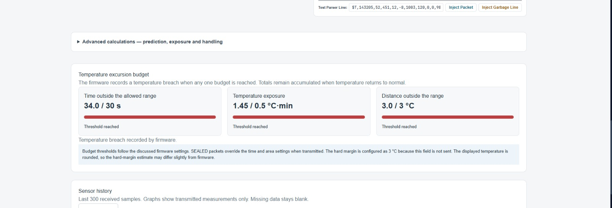
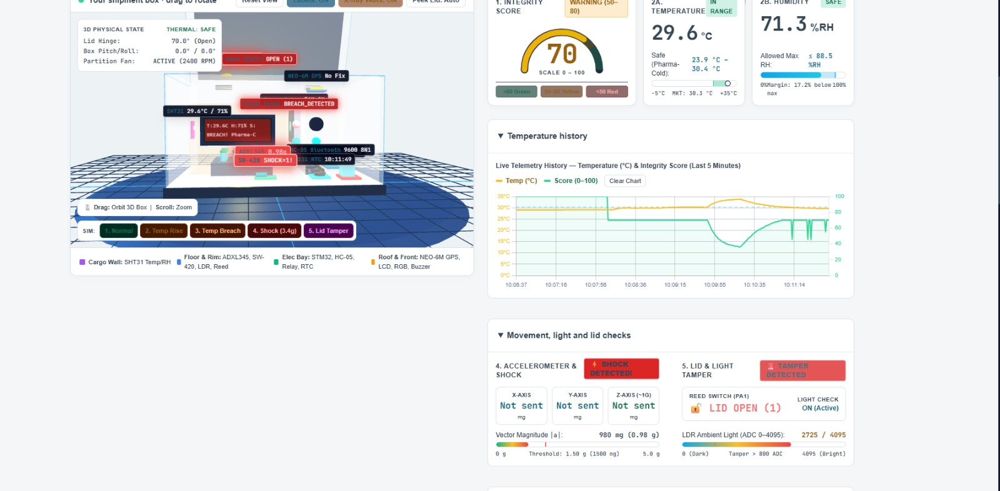
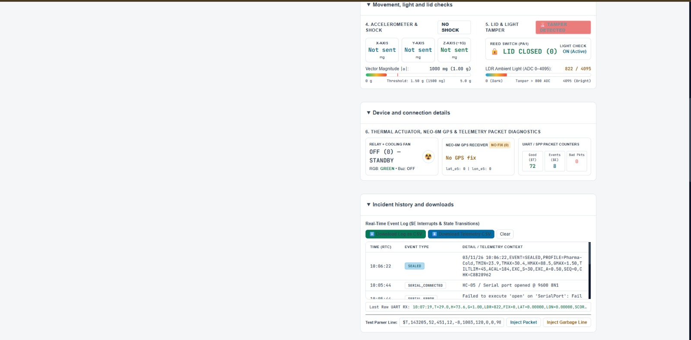
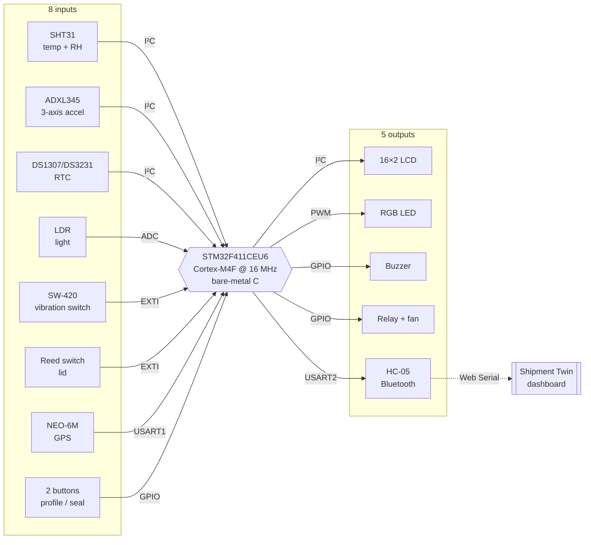

<div align="center">

# 📦 Shipment Integrity Monitor

**An ARM Cortex-M4 black box that rides inside a shipment and records, with tamper-evident proof, every time it was heated, dropped, tilted, exposed to light or opened.**


[](LICENSE)



<sub><i>The finished unit: LCD, status LED and the two control buttons on the box, streaming over Bluetooth to the live dashboard.</i></sub>

</div>

---

## Why it exists

Goods in transit can be warmed, dropped or opened, and nobody finds out until delivery, when it's too late to say **when** or **who**. For cold-chain cargo such as vaccines, a single excursion can make a product unsafe even though it looks fine.

This unit turns handling into **evidence**:

- 🔒 **Latched breaches.** A violation cannot be cleared until delivery.
- 🕒 **Time and place.** Each record carries an RTC timestamp and a GPS position.
- 🔗 **Hash-chained log.** Editing or deleting a line after the trip is detectable.
- ⚖️ **Fair limits.** Medicine, electronics and fresh produce are each judged by their own profile.

## 🎬 Demo

<!-- 🎥 VIDEO: on github.com, edit this README and drag your .mp4 (max 100 MB) onto this line.
GitHub uploads it and inserts a link like https://github.com/user-attachments/assets/... that plays inline. -->

A real Pharma-Cold run on the hardware, captured from the live dashboard:

<table>
<tr>
<td width="50%"></td>
<td width="50%"></td>
</tr>
<tr>
<td align="center"><b>① Sealed and in transit</b><br>29.0 °C inside the 23.9 – 30.4 °C window · integrity score <b>100</b></td>
<td align="center"><b>② Box heated past the limit</b><br>33.6 °C · fan switched <b>ON</b> · score drops to <b>38</b></td>
</tr>
<tr>
<td></td>
<td></td>
</tr>
<tr>
<td align="center"><b>③ Excursion budget used up</b><br>34 s / 30 s · 1.45 / 0.5 °C·min · 3.0 / 3 °C → breach latched</td>
<td align="center"><b>④ Lid opened and box knocked</b><br>Reed switch OPEN · LDR 2725 · <b>shock detected</b></td>
</tr>
<tr>
<td colspan="2" align="center"><br><b>⑤ Diagnostics and evidence</b>: lid and light checks, fan, GPS and packet counters, and the hash-chained <code>SEALED</code> event in the incident log</td>
</tr>
</table>

### What the hardware run showed

| Check | Observed on the board | Result |
|---|---|:-:|
| Bluetooth link | HC-05 at 9600 8N1; 40 181 bytes received, no serial errors | ✅ |
| Sealing | `SEALED` line with Pharma-Cold demo limits 23.9 – 30.4 °C, RH ≤ 88.5 %, 1.50 g, `SEQ=0` | ✅ |
| Temperature breach | Heated to 33.6 °C; all three excursion budgets exceeded and a breach latched | ✅ |
| Cooling fan | Relay and fan switched ON when the box overheated | ✅ |
| Lid and light tamper | Reed switch read OPEN; LDR rose from about 734 to 2725 counts | ✅ |
| Shock | Knock detected and reported | ✅ |
| Integrity score | 100 in normal transit, 70 after lid and shock, 38 during the temperature breach | ✅ |
| GPS | No fix indoors (`FIX=0`), as expected without open sky | ⚠️ |

---

## Highlights

| | |
|---|---|
| 🧠 **Real on-chip computation** | Mean Kinetic Temperature, least-squares trend with time-to-limit, excursion budgets, drop height, tilt geometry and vibration RMS, all running on the Cortex-M4F |
| 🔀 **Sensor fusion** | A shock counts only when the ADXL345 *and* the SW-420 agree within 300 ms |
| 🌡️ **Predictive cooling** | The fan starts **before** the limit, as soon as the trend predicts a breach within 120 s |
| 🔗 **Tamper evidence** | The hardware CRC-32 unit chains every log line (`SEQ` + `CHK`) |
| 🛡️ **Robust by design** | Every I²C wait has a time-out, failed sensors are flagged rather than hanging the system, and there is a boot self-test |
| ⏱️ **Measured cost** | The DWT cycle counter times every algorithm and reports it in a `BENCH` line |
| 🧮 **No libraries** | Hand-written `sqrt`, `exp`, `ln` and `atan2`; only the CMSIS register header is used |
| 📺 **Digital twin** | A single-file HTML dashboard: live over Bluetooth, log replay and an independent chain check |

---

## System at a glance



**Lifecycle:** `MENU` (pick a profile) → `WAIT_SEAL` (close the lid) → `IN_TRANSIT` (sense, compute and log every second) → `DELIVERED` (hold both buttons for 2 s to write a summary and verdict)

---

## Cargo profiles

| Check | 💊 Pharma-Cold | 💻 Electronics | 🥬 Produce |
|---|:-:|:-:|:-:|
| Temperature | 2 – 8 °C | −10 – 45 °C | 0 – 25 °C |
| Humidity max | 60 %RH | 85 %RH | 95 %RH |
| Shock | 1.5 g | 1.3 g | 2.5 g |
| Tilt | 45° | 45° | off |
| Light tamper | on | on | off |
| Lid opening | on | on | on |

<sub>`DEMO_MODE` re-centres the Pharma-Cold and Produce temperature windows on room temperature at sealing, because a classroom is not a refrigerator. The `SEALED` log line always records the limits actually in force.</sub>

---

## What runs on the chip

| Algorithm | What it does | Key formula |
|---|---|---|
| **Filtering** | EMA on temperature; median of 5 on the LDR | $T_f \leftarrow T_f + (T - T_f)/4$ |
| **Mean Kinetic Temperature** | Arrhenius-weighted temperature (the cold-chain standard), using Kahan summation | $T_{MKT} = \dfrac{\Delta H/R}{-\ln\left(\frac{1}{n}\sum e^{-\Delta H / R T_i}\right)}$ |
| **Trend + ETA** | Least-squares slope over about 2 min; time to the limit = margin ÷ rate | $m = \dfrac{\sum (t-\bar t)(T-\bar T)}{\sum (t-\bar t)^2}$ |
| **Excursion budget** | Warning first; breach when time (30 s), area (0.5 °C·min) or margin (3 °C) is exceeded | $\int \lvert T - T_{lim} \rvert\,dt$ |
| **Drop height** | Free fall (< 0.4 g) duration → equivalent height | $h = \tfrac12 g t^2$ |
| **Tilt** | Angle from the gravity vector recorded at sealing | $\theta = \operatorname{atan2}(\lVert a \times r \rVert,\ a \cdot r)$ |
| **Vibration** | RMS deviation from 1 g per sample | $\sqrt{\overline{(\lvert a \rvert - 1g)^2}}$ |
| **Integrity score** | 100 minus penalties (temp ≤ 40, RH 10, shock 25, tilt 15, light 30) | — |

**Worked example:** 23 h at 20 °C plus 1 h at 40 °C gives a plain mean of **20.83 °C** but an MKT of **22.45 °C**. The hot hour does more damage than an average suggests.

Full derivations and verification are in [`docs/ALGORITHMS.md`](docs/ALGORITHMS.md).


---

## Tamper-evident log

Every line after sealing ends with a sequence number and a CRC-32 that covers **this line and every line before it**:

```text
14:01:46,EVENT=SHOCK_CONFIRMED,PEAK=2.31,SEQ=97,CHK=E6EF58B6
14:02:08,EVENT=DROP,HEIGHT_CM=19,FALL_MS=200,PEAK=4.95,SEQ=121,CHK=0762E327
14:02:56,SUMMARY,PROFILE=Pharma-Cold,…,VERDICT=FAIL,SEQ=174,CHK=CF2CB4BB
```

- ✏️ **Edit a line** and its check fails, along with every check after it.
- 🕳️ **Delete a line** and a gap appears in `SEQ`, so lost data is distinguishable from an edit.
- 🖥️ The dashboard recomputes the chain in JavaScript and points to the **first bad line**:


> ⚠️ A CRC chain is **tamper-evident, not tamper-proof**: someone who knows the key and the algorithm could rebuild it. A production unit would use an HMAC or a digital signature.

Or verify any saved log offline, with no browser needed:

```console
$ python tools/verify_log.py samples/sample_log.txt
Lines checked : 176
Missing (SEQ) : 0
Mismatched    : 0
RESULT        : INTACT ✅
```

Field reference and event list: [`docs/LOG_FORMAT.md`](docs/LOG_FORMAT.md)

---

## Quick start

### 1 · Try the dashboard (no hardware needed)

Open [`dashboard/shipment_twin.html`](dashboard/shipment_twin.html) in **Chrome or Edge**, then:

- **Play sample run** replays a full Pharma-Cold trip
- **Demo: edit a log line** alters one reading and shows the chain break
- **Open log file** loads [`samples/sample_log.txt`](samples/sample_log.txt) or your own log
- **Save log** downloads the current session for `tools/verify_log.py`

### 2 · Build and flash the firmware

[`firmware/main.c`](firmware/main.c) is a single register-level source file. It needs only the CMSIS headers plus a startup file and linker script:

1. In **STM32CubeIDE**, create an *Empty* STM32 project for **STM32F411CEUx**.
2. Replace `Src/main.c` with `firmware/main.c`, add the CMSIS headers and define `STM32F411xE`.
3. Build and flash with an ST-Link (SWD) or over USB DFU.
4. Pair the HC-05, then click **Connect HC-05** in the dashboard (9600 8N1).

Exact header list, settings, the pin map and first-time RTC setup are in [`firmware/README.md`](firmware/README.md).

---

## Hardware

| Part | Interface | Pins |
|---|---|---|
| STM32F411CEU6 "Black Pill" | — | 16 MHz HSI, USB power bank |
| SHT31 · ADXL345 · RTC · 16×2 LCD (PCF8574) | I²C1 @ 100 kHz | PB6 SCL · PB7 SDA |
| LDR (voltage divider) | ADC1 ch0 | PA0 |
| Reed switch · SW-420 | EXTI1 · EXTI0 | PA1 · PB0 |
| NEO-6M GPS | USART1 9600 | PA9 · PA10 |
| HC-05 Bluetooth | USART2 9600 | PA2 · PA3 |
| RGB LED | TIM3 / TIM2 PWM 1 kHz | PB4 R · PB5 G · PB3 B |
| Buzzer · relay + fan | GPIO | PB8 · PB9 (active-low relay) |
| Profile · confirm buttons | GPIO, pull-up | PB12 · PB13 |

The bill of materials, component choices and design decisions are in [`docs/HARDWARE.md`](docs/HARDWARE.md).

---

## Repository

```
shipment-integrity-monitor/
├── firmware/
│   ├── main.c                     # complete bare-metal firmware (≈2.2k lines)
│   └── README.md                  # build, flash, settings, RTC setup
├── dashboard/
│   └── shipment_twin.html         # single-file digital twin (Web Serial + replay + chain check)
├── tools/
│   └── verify_log.py              # offline hash-chain verifier (Python, no dependencies)
├── samples/
│   └── sample_log.txt             # full sample-run log (181 lines)
├── docs/
│   ├── ALGORITHMS.md              # maths, thresholds, verification
│   ├── LOG_FORMAT.md              # fields, events, breach bits, hash chain
│   ├── HARDWARE.md                # BOM, alternatives, design decisions
│   ├── project_report.docx        # full project report
│   ├── code_and_computations.pptx # presentation (30 slides)
│   └── guide_and_demo_plan.pdf    # complete guide + 12-step demo script
├── media/                         # hardware photo and live-dashboard screenshots
└── LICENSE
```

---

## Limitations

- **Tamper-evident, not tamper-proof.** The CRC chain can be rebuilt by someone who knows the key.
- **Drop height is an equivalent height** worked out from free-fall time, not a measured distance.
- **Tilt is relative to the sealed orientation**, so seal the box upright and still.
- **Excursion budgets are scaled down for the demo.** Real values must come from product stability data.
- **GPS needs open sky.** Indoors, the log shows `FIX=0`.
- **The sample run is simulated.** Its `BENCH` cycle counts are illustrative; real figures come from the board.

## Roadmap

`HMAC / signature log` · `battery-backed flash storage` · `LoRa / cellular uplink` · `low-power sleep between samples` · `stability-data-driven budgets`

---

<div align="center">

Built for **23ELC302 · Embedded Systems** · STM32F411 · Bare-metal C

<sub>Datasheets: <a href="https://www.st.com/en/microcontrollers-microprocessors/stm32f411ce.html">STM32F411CE</a> · <a href="https://www.st.com/resource/en/reference_manual/dm00119316.pdf">RM0383 reference manual</a></sub>

</div>
